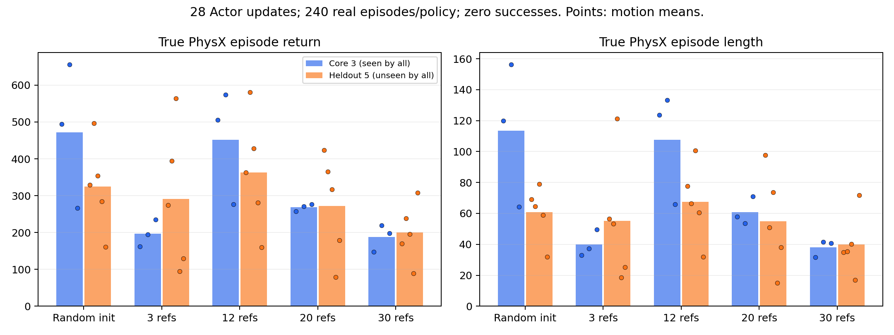

# GALATEA × SuperMimic：首轮核查与实验方案

核查日期：2026-11-04（America/Los_Angeles）。范围：环境、官方资产、论文、源码、数据文件；没有运行 PhysX 评估或训练，没有修改官方源码。

**结论：先在 GALATEA 原生 Power Drill 数据上建立受控对照；旧方案只能称为 SuperMimic 风格原型。当前证据不足以将失败归因于三条 Motion，也不足以证明该方法不适用于灵巧操作。**

本文区分四种证据：本机实测、上游源码/论文陈述、用户提供的历史记录、待验证假设。历史 80.7454% Expert 成功率、WM 误差与 Actor 退化数值均未在本机复验。

## A. 当前环境与恢复状况

| 项目 | 本轮实测 |
|---|---|
| GPU | NVIDIA RTX 6000 Ada Generation，49140 MiB；不是旧 RTX A6000 |
| 驱动 | 595.84；nvidia-smi 显示 CUDA 13.2 为驱动支持信息 |
| CUDA Toolkit | nvcc 12.1.105；不能把驱动显示值当成已安装 Toolkit |
| 系统 / Python | Ubuntu 20.04.6 LTS / Python 3.8.10；没有 `python` 命令 |
| 初始 Python 包 | pip、NumPy、PyTorch、Isaac Gym 均未安装 |
| 磁盘 / 共享内存 | 开始检查时根文件系统 150G、可用约147G；/dev/shm 47G |
| 内存 | 主机可见188GiB；容器配额需在正式训练前再次检查 |
| 旧项目 | /root/workspace、/workspace 初始为空；检查 /mnt、/home、/opt 等未发现项目备份 |
| 持久化 | 未发现挂载到研究目录的独立持久化卷；当前文件仍可能随实例丢失 |

官方源码已克隆到 `sources/GALATEA`，固定 commit `36b90481ba458d9beb5b6ac1396c639ea49a4747`，工作树干净。[官方仓库](https://github.com/boyuan-an/GALATEA/tree/36b90481ba458d9beb5b6ac1396c639ea49a4747)

已恢复官方 `rl-v1.0` 的全部9个发布文件：三个物体各自的预处理数据、raw 数据和 Expert checkpoint。逐个核对发布页 SHA-256，均通过；权重仅下载，未加载或评估。机器人 URDF、网格来自官方仓库，数据内包含物体网格、碰撞模型与 arm reset IK。原始和处理后文件位于同一物体目录下的不同子目录，未混合进旧工程。[发布页](https://github.com/boyuan-an/GALATEA/releases/tag/rl-v1.0)

没有发现可信的旧 WM/Actor 权重、旧日志或旧代码。这个结论仅限当前可见文件系统；没有账户内旧磁盘或私有备份位置的证据，不能宣称它们已永久丢失。

运行环境尚未恢复。当前只在 `audit-lib/` 放置读取文件所需的 NumPy、pypdf、typing_extensions，通过临时 PYTHONPATH 使用，未安装训练环境。Isaac Gym 官方下载端点 HEAD 返回200、约201MB；没有下载安装。MANO_RIGHT.pkl 未找到，官方不随发布包分发，需要使用者已获许可的文件。[GALATEA安装说明](https://github.com/boyuan-an/GALATEA/blob/36b90481ba458d9beb5b6ac1396c639ea49a4747/rl/README.md)

恢复建议：单独建立 Python3.8 环境，按官方要求固定 torch2.4.1、numpy1.23.0 与 CUDA12.1 组合，再安装指定版本扩展。Ubuntu/Python符合 Isaac Gym Preview4 文档，但新驱动下运行、PyTorch CUDA算子、PyTorch3D/chamfer扩展编译仍需实际 smoke test。Isaac Gym 已停止支持，不能仅凭 nvidia-smi 正常就声称 PhysX 可运行。[NVIDIA要求](https://developer.nvidia.com/isaac-gym/download)

## B. 论文与复现真实性

**作者代码状态：截至本次核查，作者项目页未提供训练仓库链接，仓库搜索也没有找到可由作者身份确认的训练实现。因此本轮未取得官方训练代码；这不是对所有未索引或私有代码的断言。**[作者主页](https://supermimic.github.io/)

发现的社区实现包括：

- [zita-ch/supermimic_vibed](https://github.com/zita-ch/supermimic_vibed)：README明确标注非官方，并说明快速生成、未经充分审查。
- [CuboiLeo/SuperMimic-Reproduced](https://github.com/CuboiLeo/SuperMimic-Reproduced)：明确声明独立重实现、与作者无关；其 canonical state、显式积分、FK 和解析 head 是该仓库的实现，不能自动归为论文规定。

本轮只审阅这两个仓库的说明与来源，不背书其结果，也未完成其源码逐行审计。若用于原生任务对照，需固定 commit、审计关键梯度路径，并在报告标题中保留“社区实现”字样。

以下是论文明确披露的复现要点；用于核对，不作为完整论文重述。[SuperMimic原文：§3、Fig.4、Appendix A–F](https://arxiv.org/pdf/2610.28480)

| 核对项 | 论文规格 | 旧工程记录 / 本次判断 |
|---|---|---|
| Motion | LAFAN1：40条/2.45h；BONES-SEED：129514条/264.56h | GALATEA三条；跨任务与规模均不同。2.45h是论文报告值，未独立累计LAFAN文件 |
| 规模消融 | 1/7/40/264h；8步归一化状态误差约0.007–0.011 | 未发现三条短片、单条或秒级总量的直接实验 |
| WM | MLP(2048,2048,2048)，输入状态/动作/context，输出下一状态 | 旧小型MLP是工程近似；确切层宽、参数量与版本未恢复 |
| 状态/head | 噪声外置；head可学习或解析 | 411D/608D不是论文标准；完整状态编码、具体积分/FK/head选择未充分披露 |
| Reference/Actor | 10个未来参考帧；32D latent；10帧观测历史；encoder/decoder均(2048,1024,512,256) | 旧conditioning与history待查，不能假定相同 |
| 时域 | 50Hz；k=8、H=32，即0.16/0.64s | 当前GALATEA30Hz对应0.267/1.067s；旧频率未知 |
| WM监督 | 自回归窗口；状态及学习式head监督 | 旧Response Loss、hybrid contact等属于自定义 |
| 采集 | 当前策略+σ0.1动作噪声，保存执行动作；4096环境；每环境1000步buffer | 旧采样/执行动作记录契约未恢复 |
| Reset | 1秒分桶，uniform/hard/history混合50/40/10 | 当前GALATEA按有效reset帧采样；不同算法 |
| Critic | (256,128)；imagined TD(λ=.95)，γ=.99；无EMA target | 历史Critic专项验证未完成 |
| Actor/Done | 冻结WM权重的BPTT；soft survival；terminal bootstrap | 原型流程相似不等于梯度/索引/终止语义一致 |
| 随机化 | 摩擦、关节偏置、躯干CoM，context可见 | GALATEA还有控制历史、延迟、mask及课程状态 |
| 更新预算 | WM每次10×2048窗口；Actor批4096；UTD=.4 | 不能用旧Outer Iteration数量直接比交互量或算力 |

论文的buffer容量是容量，不能当训练总交互量；没有根据UTD和迭代数擅自推导总PhysX transitions。它的原生仿真器是MuJoCo Warp，迁移到PhysX本身就是方法适配。[作者项目页](https://supermimic.github.io/)

**比盲目扩量更应先排除的两项接口问题：**

1. **状态是否包含足够的控制历史。** 当前GALATEA的动作先经过随机0/1步延迟，再做平滑、deadband、mask与限幅。手臂目标相对当前q，手指目标映射到关节区间，二者也不是同一种控制语义。相同q/qd和Actor输出不必产生同一下一状态。若旧WM遗漏prev_targets、action_history、mask状态或随机参数，就可能学到平均响应。旧608D context是否已覆盖这些内容未知，不能判定旧工程一定有此缺陷。
2. **时间与监督口径。** 当前源码用60Hz计算参考速度，但动作及reference索引按30Hz推进；该差异应先复验和记录，不能立即改成30Hz，否则同时改变官方Expert的输入/奖励语义。另需检查记录的是发出动作、延迟后动作还是最终PD目标，以及transition是否错误跨reset。

上述判断来自本轮源码检查，属于候选解释，尚未通过PhysX受控试验证实。来源：`armhand/envs/arm_hand_track.py` 的 `pre_physics_step/_delay_actions`，`armhand/data/demo_dataset.py`，`cfg/task/ArmHandTrack.yaml`。

## C. GALATEA Reference 实际盘点

以下为本机下载文件逐条读取结果，全部具备motion/IK/mesh/collision文件、数值有限，motion长度与IK长度吻合。**“文件完整”不等于已证明每条能在PhysX成功执行。** 每条记录、SHA和时长见 `evidence/motion_inventory.csv`；raw见 `evidence/raw_inventory.csv`。

| 物体 | raw条数 | 预处理条数/默认配置条数 | 预处理帧数范围 | 按源码30Hz推进的总跨度 | 可采reset帧数合计 |
|---|---:|---:|---:|---:|---:|
| power_drill | 44 | 35 | 1065–1380 | 1395.60s（23.26min） | 5599 |
| dog | 60 | 57 | 985–1428 | 2222.40s（37.04min） | 16181 |
| old_camera2 | 47 | 45 | 1017–1422 | 1786.63s（29.78min） | 32960 |
| 合计 | 151 | 137 | — | 5404.63s（90.08min） | 54740 |

时长统一使用首末帧时间跨度 `(T-1)/30`，不是一次实际episode生存时长。最大episodeLength=2000，本批数据未被这个上限截断；真实failure会提前结束。137条是当前公开示例release的数量，不能拿论文“超过1500条grounded”代替本地可用数量。[官方项目范围](https://github.com/boyuan-an/GALATEA/blob/36b90481ba458d9beb5b6ac1396c639ea49a4747/README.md)

所有151条raw均为121帧、24Hz，首末跨度5秒，合计755秒。当前处理后数据经历重采样、慢放与retiming，因此90分钟不代表90分钟独立原始动作。raw名包含grasp_move、table_push、pose_view；预处理manifest仅保留g编号，缺少可靠raw→g溯源表，不能按同号硬连。

| 当前Power Drill ID | 帧数 | 源码推导播放跨度 | 可采reset帧数 |
|---|---:|---:|---:|
| g16 | 1065 | 35.4667s | 335 |
| g25 | 1217 | 40.5333s | 125 |
| g26 | 1242 | 41.3667s | 341 |

三条合计117.3667秒、801个可采reset帧；这些帧高度相关，不能视为801个独立接触事件。旧数据未恢复，所以这里只能建立“当前发布版同ID基线”，不能宣称精确复现历史三条。预处理motion.npy本身未保存fps，上面的播放时间由源码推导；`referenceFps=60`对应的导数时间口径另列在CSV，不冒称数据内时间戳。

**采样逻辑：** 环境根据物体surface points分组，在同组demo中均匀抽取；reset从`reset_collision_free`且帧号小于`floor(0.98*T)`的集合中均匀抽取。若关闭randomStateInit则从首帧开始。动作每次推进一帧reference。各物体组内mesh字节SHA相同，Power Drill有35个不同motion文件SHA；这支持同资产扩量，但尚未量化几何轨迹近重复程度或真实pad接触多样性。

预处理137条可直接作为官方loader输入，仍依赖MANO和完整环境。raw151条不能直接训练，需要质量筛选、MANO转换、场景放置、IK、安全reset、retiming、碰撞模型等步骤；不将raw与已处理数据重复相加。

## D. 对“Motion太少”假设的判断

1. **可能吗？** 可能。三条参考可能覆盖很窄的手姿、接触组合、物体速度与恢复状态。但这是合理假设，不是本轮证实的原因。
2. **为何20万以上transitions仍不足？** 同一接触过程附近反复采样、慢放后的相邻帧、早停后的重置都会产生很多相关数据。数量增加不保证出现新的动作后果；action扰动太小或控制器deadband也可能削弱可辨识响应。
3. **Motion与PhysX数据量区别？** 前者改变目标和访问状态的支持范围；后者增加对这些范围内动力学的观测。新Motion不保证被策略实际执行到，更多交互也不保证增加独立接触事件。
4. **论文是否支持？** 提供大范围扩展可行的证据，未直接检验本项目三条短Motion的失败机制；其误差随规模大致稳定，也不能解读为“数据越多WM误差必然越低”。
5. **优先排查什么？** 执行动作和控制历史契约、时间尺度、reset/terminal边界、模型容量与conditioning、可微head选择。历史Critic和termination也没有被排除。
6. **最低成本的因果试验？** 先固定数据采集器和WM，把Motion集合与独立transition预算做2×2对照，Actor暂不更新；在共同验证集上比较动作响应和多步误差。若接口不闭合，先修复并冻结契约，再开始整个矩阵，避免一边改模型一边比较数据量。

过去的response方向、幅度、q/qd、FK异常是值得重测的历史线索。它们既不证明三条Motion是原因，也不构成继续叠加loss的理由。

## E. 可执行实验矩阵与停止条件

以下是**待批准执行的预算方案**，不是已经运行的实验或速度预测。所有训练计时用本机RTX6000 Ada实测，不以论文H100小时数折算。

| 阶段 | 执行内容 | 放行条件 | GPU预算上限建议 |
|---|---|---|---|
| 1 恢复 | Python环境、Isaac Gym、MANO、官方loader；16环境物理smoke，随后96/128环境官方首帧评估 | robot/object加载正常；无NaN；done/reward可追踪；完整config/日志 | 安装主要CPU；GPU烟测与评估累计≤0.5h |
| 2 审计 | 执行动作与target/history记录；reset重放；频率计数；数据切分；WM接口与论文差异表 | 固定状态契约、单位、控制时间；正负扰动可重复；无跨episode监督 | ≤0.5h；单项无进展停止并报告 |
| 3a 最小筛查 | 3/12 Motion × 200k/800k训练transitions；先1 seed，固定WM | 数据清单与共同验证集冻结；先报告4组结果 | 每WM≤0.5h，采集/验证合计≤1h；总≤3h |
| 3b 确认 | 同2×2矩阵共3个seed，随后有证据才扩28条 | 筛查出现可解释差异或需排除seed偶然性 | 12个WM fit总≤6h，采集/验证≤2h；3a计入 |
| 4 完整MBRL | 先单独验证termination/critic，再Actor；与PPO同口径比较 | WM在预定horizon优于简单基线，动作响应可信，真实价值/终止校准通过 | 初始2算法×2数据组×3seed×1h≤12h，加评估≤2h；不自动延长 |

**数据集合：** Power Drill35条中先固定7条为独立Motion验证集，剩余28条可训练。训练核心为g16/g25/g26；12条组包含这三条，再从剩余训练候选按轨迹差异、有效reset范围和接触阶段分层选择。选择规则和ID在采集前冻结；不虚构现在已有“12条最佳清单”。28条作为第二轮扩展。35条全量只用于最后的训练集coverage报告，不能继续把那7条称作未见数据。

**2×2四组：** S3/B200k、S12/B200k、S3/B800k、S12/B800k。先为每个Motion集合采800k条真实训练转移，200k为固定随机种子分层子样本；另采不计入训练的验证episodes。两个预算组不能复用同一episode的重叠窗口作为验证。三seed首先衡量WM优化随机性；采集数据若共用，需明确它不是三个独立采集重复，正面结果再用新采集seed确认。

**采集器：** 第一轮使用冻结官方Expert加同一预先规定噪声/探索混合，作用在同一控制管线，所有组使用相同动作扰动规则、课程状态、物理随机化分布和噪声尺度。记录command、延迟后动作、PD target、prev_targets、mask/history和domain context。额外固定一组失败/恢复测试分布，避免只测Expert附近。官方Expert可能见过全部35条：这轮衡量WM的数据覆盖，不是端到端from-scratch效率；预训练成本与验证集通过teacher产生的间接信息必须披露。

**固定因素：** 同一代码commit、模型结构与参数量、loss、normalization策略、优化器、batch、梯度步数、采集策略、物体网格/质量分布、控制频率、reset规则、transition单位与evaluation seeds。主要矩阵固定优化步数以比较数据效用，同时报告每条样本被访问次数；若追加等epoch实验，必须另列，因为计算预算变化。运行顺序随机化，防止负载和温度系统性偏差。

**验证集分两层：** (i)核心三条中独立episodes，判断额外Motion是否改善共同动力学；(ii)7条完全未用于WM拟合的Motion，判断跨Motion预测。再记录训练分布指标但不混入这两层。按完整episode/source motion分割，窗口不跨done；几何近重复源应同组，不能简单随机拆帧。

**指标：** 1/4/8/16/32步状态误差，并标注秒数；q/qd、指尖、物体姿态；persistence与简单恒速基线；首次接触/持续接触/无接触分层；动作响应方向、幅度比及reward差符号。扰动持续1/4/8/16步，观察撤回后的响应；近零真实响应单独报告，避免比值失真。测试保持完整控制历史与随机数相同，以重复无扰动轨迹估计PhysX噪声底线；不能只恢复q/qd就称相同物理历史。另报占用状态区域、action分布、独立接触episode数和窗口相关性。

**拆分数量、时长和多样性：** 3→12条主矩阵检验“更丰富参考集合”的组合效应，不能独断归因Motion数量。若主效应存在，追加90秒有效参考支持范围对照：3×30秒 vs 12×7.5秒，匹配接触阶段与采样预算；窗口只约束数据来源，不改变完整episode评价。固定3条再比较各15秒/30秒支持范围，评估长度效应。精确窗口须看实际接触分布后冻结；若无法匹配阶段，结论注明残余混杂。重复切片或8倍慢放不算增加独立Motion。

**支持假设的结果：** 同B和同计算下，更丰富集合在共同验证集上稳定改善多步状态及动作响应，随后带来真实PhysX Actor改善。只有holdout变好而核心三条不变，只支持泛化收益；只有B增加有效，支持采样量不足；只有state MAE下降而action-response/Actor不改善，不能解释旧BPTT失败。

**削弱假设的结果：** 统计不确定性可接受时，更多Motion没有稳定增益，而固定数据的契约修复或容量对照有效。但无显著差异不等于证明无效，尤其每Motion样本被稀释、探索不足或未收敛时。置信区间以episode/Motion为单位，不把相关帧当独立样本。

**阶段4：** Learned termination先检查校准、危险漏判、对接触阶段的偏差，并区分环境failure、reference结束和time-limit截断；Critic对照同初态真实PhysX return、排序与bootstrap偏差。Actor更新用冻结参数但保留对state/action求导的WM，另检查critic bootstrap输入梯度。先短更新验证真实收益，再完整交替；评价必须使用真实PhysX，记录success、episode length、failure reason、reward、action饱和率、交互量、GPU时间和seed。

**PPO公平性：** from-scratch与Expert warm-start分开；同transition预算曲线和同GPU小时曲线分别报告，收集/WM训练/Actor/Critic/eval时间都计账。相同成功率比较必须双方实际达到阈值；未达到则记为预算内未达标，不能外推“节省倍数”。历史71分钟与30分钟结果不构成公平优劣结论。

**停止规则：** 不完整状态契约、reset跨界、数值异常先停止矩阵；H步WM持续劣于persistence/恒速或动作响应不可信，不进入Actor。每run到时间或transition上限即停并记censored，不自行加预算。两次预先固定评价中真实return/episode length明显恶化则停止Actor排查；success采用episode级区间，避免96例的小波动误判。保留所有失败run，不追加第16/32步response loss或扫lambda来替代解释。

**原生SuperMimic路线：** 若取得作者代码，先40条LAFAN1基线，再3条完整/3条短窗口/更多条等总时长对照；始终固定机器人、模拟器、Reward和预算。若只能用社区代码，先审计并复核其40条基线，再做同一实现内的数据对照；这只能回答该实现的敏感性。建议作为独立支线，在GALATEA最小WM矩阵后决定是否投入；首次原生试验设单run≤2h、总≤6h，不以复现论文算力数字为完成标准。

## GRAB的定位

GRAB包含独立MANO手部参数、SMPL-X身体、刚体物体位姿、mesh和接触信息，数据说明标为120fps，具备构造HOI参考所需内容。但MANO个体模板、pose定义、单位/坐标、物体旋转约定均要转换核对；不能将其npz直接当GALATEA可执行机器人轨迹。[GRAB官方格式](https://github.com/otaheri/GRAB)

迁移需：统一右手/单手任务与mesh尺度；转GALATEA raw格式；MANO/关键点到Sharpa的跟踪对应、Franka工作空间放置与IK；对象碰撞分解/质量惯量和摩擦；速度限制、不可达与穿透筛选；最后PhysX grounding。GRAB的参考接触不等于机器人pad接触。可先复用官方preprocess，不预设必须改Reward；涉及双手、身体支撑或新物体机制时，可能需要新任务定义。

工程估计：一个物体少数序列格式验证约2–5个工程日，稳定批量与物理验证约1–3周，取决于模型许可、IK通过率及mesh可用性，尚非实测工期。当前原生35条足以开始对照，GRAB应留作独立扩展。

官方要求注册和许可，限制非商业用途、再分发及个体数据使用；具体备份不能一律套用无限多副本策略。未下载GRAB，不代用户接受许可。[数据主页](https://grab.is.tue.mpg.de/) [许可条款](https://grab.is.tue.mpg.de/license.html)

## F. 版本、备份与恢复

本轮新建独立本地Git仓库保存报告、盘点脚本、CSV、环境及发布manifest；官方仓库作为独立source checkout保持干净。二进制、数据、工具库和外部原文不纳入研究Git；没有公开上传。

正式实验目录：`runs/<date>_<stage>_<group>_seed<seed>/`，必须保存resolved config、代码commit与dirty diff、数据manifest/hash、完整采集/验证seed、环境lock、metrics.jsonl、失败原因、资源计时。checkpoint应包含actor/WM/critic/optimizers/normalizers/RNG/sampler/curriculum和replay状态；不能恢复的PhysX隐藏状态需标为重新启动采集，不伪称逐步精确续训。

备份执行方案：

1. 源码每次稳定改动commit；每次实验结束生成Git bundle、配置/CSV/日志归档及SHA256清单。
2. 发布数据保留来源URL、release ID、digest和获取日期；可重下载的文件也要验证哈希，不能静默使用更新资产。
3. 用户指定的私有持久化位置用于源码bundle、结果和自有模型；每30分钟或关键里程碑同步最新与最佳checkpoint，实验结束同步完整记录。这里是未来运行流程，未设置定时任务。
4. 受限资产按各自许可保存；MANO/GRAB不上传公开仓库，备份副本数按许可处理。认证由环境凭据管理，不写入命令日志、配置、Git或归档。
5. 每个重要阶段做一次恢复演练：新目录checkout commit→校验资产→重建环境→加载checkpoint→短评估→比较冻结测试集。只验证压缩包存在不算恢复测试通过。

**当前缺口：** 尚无已配置的实例外备份目的地。本地Git与bundle仍处于同一服务器故障域，不能称已经实现持久备份。下一阶段运行所缺的外部输入是合法MANO文件位置，以及私有持久化存储地址；不需要用户重述历史loss。

## 本轮文件与可重复检查

- `inventory.py`：官方数据统计程序。
- `evidence/motion_inventory.csv`：137条逐条帧数、时长、reset数与hash。
- `evidence/raw_inventory.csv`：151条raw的帧率/时长与参考contact统计；这些contact不是PhysX接触测量。
- `evidence/inventory_summary.json`：物体汇总。
- `evidence/environment.json`：本机环境快照及未执行仿真的声明。
- `evidence/release.json`、`download_checksums.json`：上游资产与本地校验记录。
- `sources/GALATEA/`、`downloads/`、`assets/`：已恢复源码、发布文件和解包数据。

重复盘点命令：

```bash
cd /root/workspace/galatea-audit
PYTHONPATH="$PWD/audit-lib" python3 inventory.py
git -C sources/GALATEA status --short
```

下一项具体工作是完成官方环境与小规模评估，以及动作/时间尺度接口验证。**本报告没有启动阶段3或4，也没有将未完成的环境恢复标成成功复现。**


# 2026-11-05：四组正式 World Model 对照结果

**实验已完成并停止。结论：增加 Motion 改善了未见 Motion 的泛化，主要收益发生在 3→12；12→20→30 不持续改善，也没有解决单步动作响应和 Reward 方向可靠性问题。暂不建议进入 Actor BPTT。**

本轮每组200000条有效训练 transitions、5000次更新；总计800000条训练数据。不是每组80万。所有模型从完全相同初始权重训练，MLP 3×2048，10447141参数，Adam lr=0.0003，batch=128，8步监督。训练脚本、数据采集策略和损失一致，只有Reference集合及由此采集的数据不同。没有Actor/Critic训练、Response Loss或官方Reward/Termination源码修改。

环境使用RTX 6000 Ada 48GB、Isaac Gym Preview4 GPU PhysX。正式训练源码提交为 `0a67295`；输入/控制契约、精确配置和哈希见 `experiments/wm4_200k/execution_lock.json`。这是新实现的统一工程基线，不是恢复的旧WM，也不等于SuperMimic作者完整复现。

## 1. 独立状态预测：原三条与未见五条分开

core是g16/g25/g26的独立episode；unseen是完全未用于训练、归一化或调参的g3/g9/g14/g22/g33。共同测试集分别有12000/20000条有效转移。每个模型使用相同窗口；8/32步均不跨reset。误差越低越好，Contact F1越高越好。32步约1.067秒，8步约0.267秒。

### 原三条 Motion：8步

|训练Motion|手指q MAE (mrad)|手指qd MAE (rad/s)|指尖误差 (mm)|物体位置误差 (mm)|物体旋转误差 (°)|Contact F1|Reward MAE|
|---:|---:|---:|---:|---:|---:|---:|---:|
|3|15.43|0.112|4.09|2.88|1.16|0.505|0.558|
|12|16.22|0.119|4.54|3.41|1.37|0.394|0.634|
|20|17.02|0.123|4.94|3.34|1.31|0.313|0.656|
|30|17.94|0.127|5.12|3.65|1.43|0.356|0.645|

测试窗口数：2048，涉及406个episode。保持当前状态不变的persistence基线：手指q 85.82 mrad、指尖21.89 mm、物体位置6.86 mm、Contact F1=0.401。

### 原三条 Motion：32步

|训练Motion|手指q MAE (mrad)|手指qd MAE (rad/s)|指尖误差 (mm)|物体位置误差 (mm)|物体旋转误差 (°)|Contact F1|Reward MAE|
|---:|---:|---:|---:|---:|---:|---:|---:|
|3|26.99|0.140|9.90|7.48|3.89|0.409|0.626|
|12|27.75|0.148|10.98|9.47|4.38|0.329|0.678|
|20|29.56|0.144|11.87|8.01|3.99|0.241|0.692|
|30|30.35|0.152|12.37|8.09|4.26|0.251|0.686|

测试窗口数：1954，涉及96个episode。保持当前状态不变的persistence基线：手指q 182.49 mrad、指尖47.41 mm、物体位置10.91 mm、Contact F1=0.123。

### 未见五条 Motion：8步

|训练Motion|手指q MAE (mrad)|手指qd MAE (rad/s)|指尖误差 (mm)|物体位置误差 (mm)|物体旋转误差 (°)|Contact F1|Reward MAE|
|---:|---:|---:|---:|---:|---:|---:|---:|
|3|34.75|0.180|9.74|5.98|2.41|0.260|1.232|
|12|16.44|0.113|4.55|4.19|1.80|0.322|0.576|
|20|16.31|0.111|4.37|3.91|1.62|0.386|0.550|
|30|16.74|0.112|4.50|3.88|1.61|0.344|0.473|

测试窗口数：2048，涉及395个episode。保持当前状态不变的persistence基线：手指q 79.85 mrad、指尖21.50 mm、物体位置5.03 mm、Contact F1=0.413。

### 未见五条 Motion：32步

|训练Motion|手指q MAE (mrad)|手指qd MAE (rad/s)|指尖误差 (mm)|物体位置误差 (mm)|物体旋转误差 (°)|Contact F1|Reward MAE|
|---:|---:|---:|---:|---:|---:|---:|---:|
|3|66.93|0.241|22.93|16.21|6.71|0.316|1.126|
|12|27.74|0.126|11.15|7.96|4.64|0.324|0.625|
|20|27.85|0.133|10.28|7.92|3.94|0.419|0.576|
|30|29.86|0.130|11.03|8.19|4.49|0.379|0.516|

测试窗口数：2048，涉及168个episode。保持当前状态不变的persistence基线：手指q 167.66 mrad、指尖50.69 mm、物体位置8.36 mm、Contact F1=0.067。

3→12使未见Motion的8步手指q误差下降约52.7%、指尖误差下降约53.2%、物体位置误差下降约30.0%。固定测试集合上的episode成组bootstrap，q误差差值为约−18.30 mrad，95%区间[−19.13, −17.50]；这不是跨训练seed或跨Motion划分的置信区间。12→20改善较小，30条并非全面优于20条。

原三条Motion上的8步q误差15.43→16.22→17.02→17.94 mrad，指尖4.10→4.54→4.94→5.12 mm；原集合上的精度有所损失。30条组每条Motion约6667条数据，只有3条组每条约66667条的十分之一。

未见Motion的Contact F1较3条组改善，但非单调；8步最好0.386仍低于persistence的0.413。32步物体误差从16.22 mm降至约8 mm，但也只是接近8.36 mm的persistence。这些改善不等于接触动力学已足够可靠。单步、恒速基线、分Motion与接触子集详表见下方CSV。

## 2. 同一完整历史下的手指动作响应

在共同基准命令上，前8步对一个手指关节动作施加±0.2扰动，然后撤回到共同命令。评估受扰关节的响应。下面只使用两条分支均未提前终止的案例；幅度比=预测差分绝对值/真实差分绝对值，中位数理想值为100%。方向统计排除真实响应低于噪声阈值的案例。

|训练Motion|未见单步幅度比|未见8步幅度比|未见32步幅度比|未见8步Reward方向正确|原三条8步幅度比|原三条8步Reward方向正确|
|---:|---:|---:|---:|---:|---:|---:|
|3|27.2%|63.1%|134.2%|58.3% (21/36)|100.2%|66.7% (18/27)|
|12|51.0%|99.8%|122.0%|61.1% (22/36)|96.4%|66.7% (18/27)|
|20|49.5%|105.6%|122.4%|47.2% (17/36)|100.3%|37.0% (10/27)|
|30|48.8%|101.9%|124.6%|52.8% (19/36)|94.1%|55.6% (15/27)|

未见Motion的1/8/32步可分辨关节响应样本分别为36/36/26；原三条为45/27/16。在这些非零响应案例上，四组受扰关节方向均为100%，**不意味着所有动作后果都预测正确**。未见8步幅度比四分位范围：3条54.6%–76.9%，12条90.5%–122.6%，20条94.0%–127.8%，30条94.3%–116.1%。

**单步仍有明显错误。** 未见Motion单步幅度从27.2%改善到约49%–51%，仍低估约一半。更重要的是，另有84个单步案例中真实关节几乎不响应（如动作延迟/mask）；模型却预测平均2.16/4.16/4.22/3.88 mrad的变化。增加Motion没有消除这种虚假即时响应。该诊断保存在 `zero_response_diagnostic.json`，不能仅用非零样本的100%方向一致率宣称动作梯度可靠。

32步在撤回扰动后仍有约22%–25%的幅度高估（12/20/30条组）。这低于历史报告约1135%的32步幅度比，但本轮架构、控制接口与采集器均不同，不能把相对历史数值的变化归因于Motion数量。原三条组在自身分布上8步幅度已经约100%，也表明历史严重失效不能简单归咎于只有3条Motion。

**Reward数值拟合变好，没有转化为可靠的动作优劣判断。** 未见8步Reward方向为21/36、22/36、17/36、19/36，没有稳定上升。32步只有21个可辨Reward差分案例，正确率分别71.4%、47.6%、47.6%、57.1%，样本更少，不能据此宣称某组能支持可靠Actor优化。

## 3. 数据覆盖与实际资源

|训练Motion|有效训练/原始PhysX转移|平均每Motion|有接触的独立episode|接触进入事件|持续接触帧|采集秒|WM训练秒|末500步日志平均Loss|
|---:|---:|---:|---:|---:|---:|---:|---:|---:|
|3|200000 / 214440|66666.7|2452|3287|11458|79.9|112.3|0.884|
|12|200000 / 218400|16666.7|1567|2344|9120|87.9|111.7|0.904|
|20|200000 / 218160|10000.0|1460|2062|7316|92.8|114.0|0.889|
|30|200000 / 221880|6666.7|2033|2573|9143|91.5|114.1|0.994|

原始PhysX转移总数872880，其中包含reset后的预热步和均衡配额之外的步；不能把800000条训练数据冒称全部仿真开销。预检、共同测试和动作响应诊断还另有仿真开销。归一化和损失只使用各组选择的200000条训练转移。末500步Loss取每25步日志的平均；各组归一化来自自己的训练数据，因此训练Loss不应代替独立测试比较。

动作协方差有效秩为26.96/26.76/27.12/27.18，动作多样性并未随Motion数大幅增加。持续接触只占训练转移的5.73%/4.56%/3.66%/4.57%，独立接触episode没有随Motion数单调增长。约90%–94%的转移落在Reference前四分之一，第三个四分之一覆盖为0。检查官方collision-free reset帧后发现，30条候选在第三个四分之一的合法reset数确为0；当前脚本采集策略也未推进到该阶段。更多Reference名称不等于更丰富的接触阶段。

四组WM训练墙钟总计约452秒；采集约352秒。包含首次作废响应测试、修复与最终评估，从正式开始到最终指标约1269.6秒（21.2分钟），未超过45分钟上限。训练总显存采样峰值约2.96GiB；采集约6.56GiB；本地实验文件约4.92GiB，均未超预算。没有启动Actor或自动扩大数据量。

## 4. 检查、测量修复与Checkpoint限制

- 正式采集逐步重算PD target，四组最大误差在约1.2e-7量级；Action裁剪、实际延迟、真实mask、控制历史、terminal-before-reset标签及窗口边界检查通过。记录的是实际质量及随机化参数，没有把标称质量当真值。
- 预检采用120环境，重放逐位一致；正式响应测试最初扩到600环境，完整前缀检查失败（未见Motion部分关节可差45mrad），因此停止并作废该批响应数据。保留证据在 `local_run/rejected_600/` 和 `local_run/replay_diagnostic.json`。随后只将测量并行数恢复为120，保持种子8201/8202与扰动规则不变；core与unseen前缀、重复物理轨迹及Reward均逐位一致。没有修改模型或查看测试分数来选择修复参数。见 `measurement_amendment.json`。
- 全部物理分支在done后继续模拟但不reset的诊断结果另存于JSON/CSV的 `all_physical_rollouts`，不作为上表的有效任务结果。合法8/32步窗口与响应案例存在存活选择偏差，且本轮只做一个训练seed和一个嵌套集合。
- WM预测使用已知外生延迟/mask结果，逐步从预测状态重算PD target；不使用未来真实状态或未来真实PD target。对未知随机延迟的边际化预测仍未验证。
- 每500次更新保存Checkpoint，四组最终权重及归一化可读回且前向一致。原保存格式把optimizer状态覆盖成描述文本，所以原Checkpoint不能精确恢复Adam续训。已在本轮结束后修复未来保存键并用含真实Adam状态的临时测试验证；没有重训或改写任何实验权重。
- 用户已取消全部实例外备份，本轮没有外部上传。文件只在当前实例，风险已由用户接受。

## 5. 对研究问题的回答

1. **Motion增加有没有改善WM？有，但主要改善泛化，收益集中在3→12。** 12/20/30整体都比3条更能预测未见Motion；20/30没有持续优于12，原三条表现还变差。
2. **是否解决手指Action Response低估？只部分解决。** 未见8步幅度明显改善，单步仍低估且对真实无效动作产生虚假即时响应，32步仍偏大。
3. **物体和Contact是否改善？未见Motion相对3条组改善，但Contact不单调，也未全面击败简单基线；原三条表现变差。**
4. **Reward判断是否可靠？Reward数值误差降低，但动作扰动造成的Reward方向没有稳定改善。**
5. **是否支持Motion太少的假设？支持“3条限制泛化覆盖”，不支持“只要增加Motion就能解决过去WM/Actor失效”。** 本轮严重欠缺中段和持续接触覆盖，并且新实现与旧原型不同。
6. **是否增加数据或启动Actor？值得研究有针对性的接触/阶段覆盖补充，但不建议直接把现有分布复制到每组80万，也不建议现在启动Actor BPTT。** 下一阶段应先证明单步动作因果响应、无效动作零响应和Reward方向可靠；本轮到此停止。

## 本机结果入口

- `experiments/wm4_200k/local_run/results.json`：完整指标与基线。
- `prediction_metrics.csv`、`action_response_metrics.csv`：四组汇总。
- `per_motion_metrics.csv`、`contact_subset_metrics.csv`：逐Motion和真实接触子集。
- `data_coverage_resources.csv`、`paired_comparisons.json`：覆盖、资源和配对episode bootstrap。
- `local_run/train_{3,12,20,30}.pt`：训练数据，含selected标记。
- `local_run/wm_{3,12,20,30}/final.pt`：最终模型。
- `LOCAL_SHA256SUMS.txt`：本地数据/模型/配置/指标校验清单；`completion.json`记录完成状态。


# 2026-11-05：8步动作脉冲的完整时间响应诊断

**结论：真实手指的额外角度通常先升高，撤回额外命令后再逐渐下降，但第32步并未归零。其实际PD target差也仍有残留。四个WM都能画出大致回落形状；更多Motion改善未见状态下的整段预测，但不单调，也没有消除错误的提前响应。**

这里“回落”指扰动分支相对基准分支的额外角度减小，不是手指绝对姿态回到最初位置。基准Action本身仍随时间变化。所有曲线都计算 **正扰动分支−基准分支**，没有拿此前正负两条扰动分支的差冒充这次结果。

## 数据与有效性

- 复用此前120环境、seed 8201/8202产生的真实GPU PhysX轨迹；没有新增仿真转移，没有训练更新，没有修改四个WM、Actor、Reward、Termination或Critic。
- 核对新建PhysX进程的完整前缀与上下文；基准重复运行所有已保存张量逐位一致，包括32步轨迹、控制和Reward。基准与正扰动分支的初始状态、控制历史、随机化参数、延迟与mask一致。
- 本轮要求两条分支从初始到第32步都没有done，连第32步终止的案例也排除；同时验证状态连续、年龄每步加1。240个候选中仅48例有效（core 18、unseen 30），192例不混入有效结果。
- 48例中36例真实响应峰值≥1°且有效PD目标差≥0.1°，作为“明显响应”统计；其余12例保留在逐例CSV和图册，并提供含弱响应的单独统计。36例中28例全程无手指接触，8例有某个手指接触；只有2例受扰手指自身短暂接触。没有足够案例支持“持续接触下已验证可靠”的结论。
- 扰动为受扰关节Action在1–8步增加0.2，第9步撤回。示例均无Action裁剪、扰动期间受扰关节无mask。控制频率30Hz。关节名称来自Isaac Gym真实DOF顺序，未使用URDF文本排列代替。
- WM采用同一个真实初态和同一Action序列、已知外生控制条件独立自回归32步；未来物理状态不回灌。PD target从模型控制历史重算，未直接输入未来真实target。四个模型的手指PD target差与实际PhysX最大差约7.63e-6°，图中曲线重合是正确控制映射的结果，不是WM学到了动力学。
- 四个Checkpoint和所有源PhysX文件的SHA-256在诊断前后相同。绘图依赖安装在独立audit-lib/plots目录，未改动训练环境或模型。

## 具体案例：五条曲线和指定时刻的角度差

所有角度数值单位为度，速度单位为度/秒；q/qd取每个控制步结束后的值，PD target为该步实际施加值。黄色区域为额外命令持续期间，绿色竖带为受扰手指实际接触阶段。总览图依次包含角度、速度、PD target、提交/延迟后的Action及mask/接触状态；单独角度图恰好五条曲线。示例按真实响应峰值的中位数选择，不按哪个WM看起来更好挑选。

### 原三条：无接触，g16食指末端关节（lane 3）


[角度、速度、PD target与控制状态完整图](experiments/wm4_200k/time_response/case_core_003.png) · [矢量PDF](experiments/wm4_200k/time_response/case_core_003.pdf)

|步数|真实PhysX|WM-3|WM-12|WM-20|WM-30|实际PD target差|
|---:|---:|---:|---:|---:|---:|---:|
|1|0.415|0.215|0.225|0.210|0.203|0.800|
|4|2.350|1.909|1.847|2.106|1.794|2.751|
|8|3.728|3.410|3.351|3.629|3.278|3.749|
|16|2.133|2.247|2.254|2.417|2.201|1.981|
|24|1.176|1.421|1.425|1.520|1.308|1.097|
|32|0.774|0.872|0.894|0.982|0.802|0.720|

真实峰值3.948°（第9步），第32步仍有0.774°，实际目标差0.720°。
初始及1–32步两条分支的所有手指均无物体pad接触。

### 原三条：出现接触，g25中指末端关节（lane 73）


[角度、速度、PD target与控制状态完整图](experiments/wm4_200k/time_response/case_core_073.png) · [矢量PDF](experiments/wm4_200k/time_response/case_core_073.pdf)

|步数|真实PhysX|WM-3|WM-12|WM-20|WM-30|实际PD target差|
|---:|---:|---:|---:|---:|---:|---:|
|1|0.000|0.144|0.136|0.163|0.164|0.000|
|4|1.674|1.620|1.419|1.712|1.698|2.168|
|8|3.860|3.234|2.966|3.574|3.337|4.174|
|16|3.239|2.492|2.093|2.585|2.289|2.989|
|24|1.376|1.328|0.913|1.281|1.084|1.287|
|32|0.595|0.854|0.428|0.701|0.542|0.615|

真实峰值4.563°（第12步），第32步仍有0.595°，实际目标差0.615°。
受扰手指接触出现在第20,21步；任意手指接触的逐步标记见图。它包含无接触→短暂自身接触→其他手指接触阶段，不能称为32步持续的受扰手指接触。

### 未见Motion：无接触，g33食指末端关节（lane 69）


[角度、速度、PD target与控制状态完整图](experiments/wm4_200k/time_response/case_unseen_069.png) · [矢量PDF](experiments/wm4_200k/time_response/case_unseen_069.pdf)

|步数|真实PhysX|WM-3|WM-12|WM-20|WM-30|实际PD target差|
|---:|---:|---:|---:|---:|---:|---:|
|1|0.000|0.105|0.169|0.133|0.186|0.000|
|4|1.163|1.030|1.522|1.520|1.619|1.691|
|8|3.382|2.190|3.099|3.055|3.302|3.861|
|16|3.311|1.897|2.320|2.233|2.349|3.108|
|24|1.760|1.254|1.320|1.313|1.238|1.623|
|32|0.893|0.851|0.754|0.826|0.725|0.854|

真实峰值3.920°（第10步），第32步仍有0.893°，实际目标差0.854°。
初始及1–32步两条分支的所有手指均无物体pad接触。

### 未见Motion：出现接触，g22小指掌指屈伸关节（lane 53）


[角度、速度、PD target与控制状态完整图](experiments/wm4_200k/time_response/case_unseen_053.png) · [矢量PDF](experiments/wm4_200k/time_response/case_unseen_053.pdf)

|步数|真实PhysX|WM-3|WM-12|WM-20|WM-30|实际PD target差|
|---:|---:|---:|---:|---:|---:|---:|
|1|0.000|0.244|0.336|0.267|0.311|0.000|
|4|2.222|1.876|2.116|2.366|2.580|2.710|
|8|3.773|3.785|3.785|4.501|4.594|4.095|
|16|2.954|3.122|2.984|3.261|3.342|2.972|
|24|1.799|2.003|1.806|1.732|2.070|1.706|
|32|0.866|1.276|1.025|0.956|1.253|0.813|

真实峰值4.422°（第10步），第32步仍有0.866°，实际目标差0.813°。
受扰手指接触出现在第18步；任意手指接触的逐步标记见图。它包含无接触→短暂自身接触→其他手指接触阶段，不能称为32步持续的受扰手指接触。

## 如何理解这些曲线

1. **撤回Action，不等于PD target立刻回到基准。** 延迟会使第9步仍执行第8步的命令；平滑、deadband和控制历史让目标差继续存在。例如g33无接触例，第9步额外提交命令已为0，但延迟后额外命令仍为0.2；第32步目标差仍0.854°，真实角度差0.893°。不能把任何非零尾部都算作WM虚假残留。

2. **真实速度差先为正，随后转负，额外角度逐渐减少。** g33例在第8步速度差为+12.48°/s，第16步为−4.90°/s，第32步仍为−1.10°/s：在窗口结束时仍在回落，不能声称已经完全回到基准。控制目标的停顿/变化使实际速度曲线不完全光滑，模型经常把这些细节抹平。

3. **更确定的错误是提前运动。** g33无接触例第1步由于延迟，实际PD target差、q差和qd差均为0；WM-3/12/20/30却预测额外角度0.105/0.169/0.133/0.186°及约4–5°/s的速度差。控制映射已经正确重算，错误在WM对动作后果的预测。

4. **最后一个点接近，不等于过程正确。** g33例WM-3的第32步0.851°接近真实0.893°，但第8步仅2.190°（真实3.382°），第16步仅1.897°（真实3.311°）。其他三组改善了前半段，却也普遍过早开始下降、漏掉真实峰值附近的平台。

5. **不是所有接触案例都随Motion增加而变好。** g25接触例WM-12明显低估峰值和中段，WM-20较接近；g22接触例WM-12整段误差较小，WM-30则高估幅度并留下偏大的尾部。具体接触时间已逐步标出；自身接触案例只有两例，不能进行强统计归纳。

## 案例差异与完整32步误差

以下先对每个案例计算32步 |预测额外角度−真实额外角度| 的平均值，再报告案例间中位数和四分位区间；不会把正负响应直接平均相消。统计对象是36个明显响应案例，原三条15例、未见Motion 21例。

|模型|原三条整段MAE，°（四分位区间）|未见整段MAE，°（四分位区间）|未见撤回后9–32步MAE中位数，°|未见第32步绝对误差中位数，°|
|---|---:|---:|---:|---:|
|WM-3|0.409（0.295–0.474）|0.566（0.409–0.709）|0.508|0.367|
|WM-12|0.429（0.284–0.566）|0.357（0.255–0.525）|0.368|0.280|
|WM-20|0.471（0.354–0.542）|0.469（0.265–0.560）|0.454|0.345|
|WM-30|0.436（0.318–0.531）|0.357（0.277–0.412）|0.360|0.278|

未见Motion的整段速度差误差中位数（°/s）依次为2.964、2.389、2.445、2.484。12/30条改善明显，20条未持续优于12；原三条上的整段角度误差没有改善。单一案例可能与总体趋势相反。

|模型|无接触案例整段MAE中位数，°（28例）|出现任意手指接触的案例整段MAE中位数，°（8例）|全体明显案例的整段MAE范围，°|
|---|---:|---:|---:|
|WM-3|0.503|0.446|0.178–1.270|
|WM-12|0.390|0.443|0.146–1.331|
|WM-20|0.473|0.467|0.145–1.416|
|WM-30|0.363|0.443|0.201–1.484|

上述接触分组是整条轨迹的分类，包含接触前后时段。仅在实际接触时间步计算的误差另见contact_phase_metrics.csv和supplementary_statistics.json，避免把无接触部分当接触性能。

真实第32步残留绝对角度：36例中位数0.715°，四分位区间0.545–0.920°，范围0.363–1.440°。相对峰值的残留中位数约17.8%，范围10.9%–81.3%；unseen lane 86仍保留约81%的峰值，说明并非所有案例都充分回落。事先定义“接近基准”为绝对残留≤0.5°且≤峰值10%，36例均未达到。这只是明确的诊断口径，不是唯一可用的工程容差。

因此，这次不能得出“PhysX已归零但WM不归零”的结论。支持的判断是：PhysX多数已明显回落，但控制器仍保留非零目标差；WM通常预测了回落趋势，却在启动时机、峰值、平台和回落速度上存在偏差。增加Motion改善未见状态下的完整过程，但不保证每一例、更不保证接触过程可靠。


## 全部本机文件

- [48个完全有效案例的逐例曲线PDF](experiments/wm4_200k/time_response/all_48_valid_cases.pdf)，包括12个弱/无明显响应案例。

- [所有有效案例逐步q/qd/PD target及差值CSV](experiments/wm4_200k/time_response/all_valid_time_series.csv)。

- [每步Action、延迟、mask及接触标记CSV](experiments/wm4_200k/time_response/all_valid_controls.csv)。

- [指定时刻数值表CSV](experiments/wm4_200k/time_response/selected_case_timepoints.csv)。

- [逐例误差与分类](experiments/wm4_200k/time_response/per_case_metrics.csv)，[候选案例与排除原因](experiments/wm4_200k/time_response/case_inventory.csv)。

- [数据、模型哈希和完整历史审计](experiments/wm4_200k/time_response/selection_and_audit.json)。

本轮仅诊断，已结束；没有模型更新、权重重写、Actor训练或外部上传。

---

# 长时动作响应、Reference 覆盖根因与最小采集修复

本轮已经结束。评估对象仍是本工程四个MLP World Model基线，不是作者SuperMimic的完整复现。没有更新任何 WM 或 Actor 权重，没有修改官方 Reward、Termination 函数、Critic、WM 架构或 Loss；没有上传任何文件。旧四组 WM 的 SHA-256 与开始时完全一致。新增内容是诊断程序、一个经真实 PhysX 验证的采集修复入口和本地实验结果。

最重要的结论：之前主要是在反复收集一个不会完成抓握的脚本的早期失败；这不是“官方 Expert 只能执行前四分之一”。换用冻结 Expert 后，中段和持续接触覆盖显著恢复。但旧 WM 仍经常把真实应当保持的角度差预测为衰减，增加 Motion 数没有解决这个问题。本轮没有重训，所以不能把采集改善说成模型已经改善。

## 1. 长时实验如何保证有效

沿用 +0.2 单个手指 Action 脉冲：第 1–8 控制步额外施加，第 9 步撤回；正扰动减基准，最长观察 256 步（30Hz，约 8.53 秒）。每批分别新建 PhysX 进程运行 base / repeat / plus，从同一 seed、Reset、物理随机化和完整预执行历史重建，不使用只恢复 q/qd 的快照。扰动分支重放基准 Action 序列；四个 WM 使用完全相同的起始输入、Action、参考序列和外部控制条件，自回归生成状态。没有输入未来真实关节/物体状态或未来真实 PD target。

原脚本 core/unseen 各两个 seed、每批 120 候选，共 480。为补足长程接触，另用冻结官方 Expert 从已验证合法的第 0 帧真实执行 128 或 512 步，再开始同样的扰动，共 240 候选。Expert 补充仅用 g16/g25/g26；它是不同采集分布的压力测试，与脚本 unseen 分开汇报。无失败标准放宽。

有效性在任一分支首次 Done 时终止：该失败步及以后不进入响应指标。没有跨 Reset 拼接。批量仿真中已终止的 lane 可能继续被底层引擎推进，其数据标为无效；仅对这些已无效 lane 限制参考索引以避免越界，绝不延长有效 Episode。Done、参考帧、进度和每步控制量保留在原始 .pt 与 CSV 中。

| 人群/批次 | 候选 | 有效32步 | 有效64步 | 有效128步 | 有效256步 |
| --- | --- | --- | --- | --- | --- |
| core | 120 | 18 | 10 | 1 | 0 |
| unseen | 120 | 30 | 17 | 2 | 1 |
| core2 | 120 | 13 | 5 | 0 | 0 |
| unseen2 | 120 | 19 | 8 | 0 | 0 |
| expert128 | 120 | 120 | 120 | 120 | 120 |
| expert512 | 120 | 120 | 120 | 120 | 79 |

上述是所有响应幅度的有效候选。主要误差统计另要求前 32 步真实峰值至少 1°、前 8 步实际 PD 差至少 0.1°：脚本 core 22 例、脚本 unseen 36 例、Expert core 77 例。动作饱和、mask、小活动范围造成的弱响应没有消失，它们仍在全案例文件和单独的全幅度统计里；不能用清晰案例的结果代表所有 Action。

“接近基准”在推理前约定为 |角度差| ≤ min(0.5°，前 32 步真实峰值的 10%)，第 9 步以后连续保持 8 步。报告的是这个连续窗口的起始步，需要再观察 7 步才能确认；不是证明未来永久等于零。另独立要求 PD target 差 ≤0.5° 连续 8 步。角度阈值、PD 阈值不同，不混为一项指标。

重放检查：脚本四批的全部保存张量完全一致，旧 core/unseen 的前 32 步也与上一轮逐位相同。接触补充批次的 q、qd、物体、刚体位姿/速度、扭矩、接触标签、Action、PD target、Done 完全一致；仅接触力读数出现不超过 3.815×10⁻⁶ N 的末位差异。接受界限限定为接触力 5×10⁻⁶ N，其他量仍要求完全一致；WM 两个分支使用同一份精确初态输入。这个例外在采样后、查看曲线排名前加入，不能说所有张量都逐位一致。

新增 unseen2 的第一次 plus 重放存在真实初始状态差异（最大关节差 0.0474rad），已整批拒绝并保留在 rejected_prefix/。只做一次同 seed 重放复查后，完整前史和基准一致性通过，才进入统计；拒绝数据没有混入结果。该首次不一致的具体底层原因尚未证实。事后用官方已解锁手速门槛复核了完整预执行历史与响应窗口：全部Expert有效轨迹通过；core lane119的扰动分支在第9步会触发该门槛，已把它的有效前缀从11步收紧到8步。原始Done值没有改写，另外标注严格门槛截尾；32步及以上主要统计完全不受影响。所有成功采集的 PD 映射重算误差不超过 1.20×10⁻⁷rad。

## 2. PhysX 是否最终回零

| 人群 | 清晰案例 | 观察到8步回落窗口 | 起始步中位数（范围） | 回落后直到观察结束均保持 | 回落窗口开始时PD差≤0.5° |
| --- | --- | --- | --- | --- | --- |
| script_core | 22 | 14 | 38（33–49） | 13 | 13 |
| script_unseen | 36 | 29 | 39（32–79） | 28 | 29 |
| expert_core | 77 | 59 | 56（32–198） | 30 | 56 |

脚本里观察到回落的案例通常在约 37–45 步（从脉冲开始计约 1.2–1.5 秒）；没观察到的 15 例大多在第 33–48 步先失败，属于观测截尾，不能判为永远不回落。Expert 情境里 59/77 例一度进入阈值，时间更分散；只有 30 例之后一直保持到观测终点。另 18 例在 209–256 步有效观察内没有连续满足阈值，其中 17 例尾段实际 PD 差仍明显非零，1 例受扰关节 PD 差已经接近零但接触运动仍在波动。

原因不只有惯性。官方 handSmoothing=0.1，handTargetDeadband=0.01rad，使用上一步 target 更新。若当前缩放后的目标与旧 target 相差不超过 0.01/0.1=0.1rad，target 可以保持不动。撤回 Action 后，两条控制历史可能停在不同的 target 上；这不是靠多等几步必然消失的量。基准本身仍在执行动作，也不是静止位置实验。

三个可核对的具体机制：

- g25/index_PIP，expert128 lane46：第32步真实角度差2.227°、PD差2.228°；四个WM却已降到0.996/0.939/0.803/0.825°。真实曲线到约第51步才离开平台，第86步开始满足回落阈值。此时尚未发生第一次手物接触（第104步），不能把平台归咎于复杂接触。
- g16/middle_DIP，expert512 lane51：第256步真实角度差1.293°，PD差也为1.293°；四个WM预测−0.242/−0.521/−0.511/−0.471°，都错误地消除了真实偏移。最后64步PD差完全恒定。这根受扰手指未接触物体，其他手指在接触，不能称为全手无接触。
- g16/thumb_MCP_FE，expert512 lane63：受扰拇指全256步都有接触，真实差一度于44步回到阈值，但256步又为−0.353°，此时该关节PD差为0，物体位置差约10.39mm、手臂target最大差约0.58°。说明受扰关节target相同也不保证整个接触系统回到同一状态。另 lane99 的尾8步角度差最大约0.596°，虽然关节target差为0，仍未达到连续8步回落标准。这里只确认伴随的状态差异，不凭该相关性断言某一种接触机制是唯一原因。


主示例按真实峰值中位数选取，优先有128步以上有效观察者；额外机制案例按“脉冲期间受扰手指接触≥4步”“真实未回落且PD持续不同”“PD已相同但未稳定”这些真实条件选择，不按WM好坏选。所有≥8步有效案例都在 long_all_valid_cases.pdf，弱响应也包括在内。

## 3. 哪个 WM 更准确

下面每个数是先对每个案例求 |预测角度差−真实角度差| 的时间平均，再取案例中位数，单位是度。没有把不同案例的正负响应相加抵消。不同 horizon 的存活人群不同，不能把长时 MAE 下降直接说成模型越预测越好；后面大量接近零的点也会稀释早期错误。

| 人群 | 步数 | 案例数 | WM-3 | WM-12 | WM-20 | WM-30 |
| --- | --- | --- | --- | --- | --- | --- |
| script_core | 32 | 22 | 0.446 | 0.485 | 0.497 | 0.469 |
| script_core | 64 | 10 | 0.318 | 0.322 | 0.277 | 0.296 |
| script_unseen | 32 | 36 | 0.579 | 0.416 | 0.431 | 0.374 |
| script_unseen | 64 | 20 | 0.419 | 0.273 | 0.274 | 0.235 |
| expert_core | 32 | 77 | 0.490 | 0.541 | 0.543 | 0.566 |
| expert_core | 64 | 77 | 0.569 | 0.618 | 0.592 | 0.612 |
| expert_core | 128 | 77 | 0.565 | 0.478 | 0.462 | 0.485 |
| expert_core | 256 | 70 | 0.437 | 0.355 | 0.346 | 0.395 |

| 128步Expert误差分布/度 | 中位数 | 25%分位 | 75%分位 | 最大 |
| --- | --- | --- | --- | --- |
| WM-3 | 0.565 | 0.289 | 0.805 | 1.810 |
| WM-12 | 0.478 | 0.307 | 0.993 | 1.975 |
| WM-20 | 0.462 | 0.275 | 0.960 | 2.139 |
| WM-30 | 0.485 | 0.315 | 0.943 | 2.005 |

这些分布明显重叠，WM-20与WM-12的中位数只差约0.016°，本轮没有多训练seed或显著性证据支持稳定排名。

脚本 unseen 的64步里，WM-30的角度差误差中位数较低；12/20/30都优于3，但12与20之间没有单调改善。脚本 unseen 能活到128步的清晰案例只有1个，不据此排名。Expert补充77个案例在128步时WM-20总体较低，但32/64步未胜过WM-3，256步也不是WM-30最好。没有一个模型在启动、峰值、平台、回落和持续接触各阶段都最好。

| Expert案例接触时机 | 案例数 | WM-3 | WM-12 | WM-20 | WM-30 |
| --- | --- | --- | --- | --- | --- |
| first_contact_later | 48 | 0.519 | 0.477 | 0.455 | 0.461 |
| initial_contact | 29 | 0.625 | 0.539 | 0.558 | 0.538 |

Expert的77个清晰案例中，48个开始时无手物接触、之后首次接触；29个开始时已有接触。真正“受扰手指在8步脉冲期间至少接触4步”的清晰案例只有11个，不能把77都称为直接接触扰动。脚本清晰案例中38个全程无接触、20个后来接触，均不是从接触中启动脉冲。另有逐步接触/持续时长与各类指标，见 long_phase_and_endpoint_audit.csv 和 long_phase_metrics.csv。本轮主要分析分支差分；两条预测共同漂移可能互相抵消，因此差分准确不等于绝对状态准确，恢复Actor前还须并列检查绝对q/qd、物体与运动学一致性。

在真实回落窗口内，Expert组四个WM也连续满足角度阈值的案例只有25/29/31/25个（真实有59个窗口）。真实没有回落的18个案例，模型却经常预测已经回落。归纳为“更多Motion就学会完整时间响应”不成立。它们改善了一部分一般误差，尚未可靠学会PD历史造成的平台与残留，以及接触后重新偏离的过程。

## 4. 原来前四分之一偏置的真实根因

旧 wm4_collect.py 的 scripted() 从未调用官方 Expert：手臂近似跟随 arm_reset_qpos，手指围绕一个偏张开的姿态做相关随机探索。四组200000条数据中，官方Expert执行中后段的次数是0，不是Expert尝试后全部失败。此前另做过官方Expert环境冒烟评估，但它没有生成这四组训练数据。

| Motion数 | 完整终止Episode数 | 长度中位数/步 | 拇指阈值失败 | 物体位置阈值失败 | 重算Done与保存值不符数 |
| --- | --- | --- | --- | --- | --- |
| 3 | 12309 | 9.0 | 10677 | 1381 | 0 |
| 12 | 9919 | 9.0 | 8450 | 754 | 0 |
| 20 | 11120 | 9.0 | 9875 | 672 | 0 |
| 30 | 12109 | 9.0 | 10977 | 669 | 0 |

失败原因允许重叠。重算使用保存的真实状态、参考目标、age与官方阈值，全部Done吻合。典型流程是 Reset 后8步宽限期，一到第9步就因拇指跟踪失败结束。平均只活17.2/21.7/19.3/18.1步；无法从早期走到数百帧后的抓握阶段。

每个旧Episode的起始帧、结束帧、长度、Done原因、接触时长和配额选中步数已导出 old_3/12/20/30_episodes.csv。末尾未Done但因采集预算结束的分别有109/110/111/111个，明确标为右截尾，不冒称真实失败。示例：旧30组g16最长一次从31帧执行到211帧、180步后拇指失败；从334帧开始的一次到343帧、9步即失败。

Reset限制来自官方预处理，不是采集器写死25%：从 reset_collision_free 为真且低于98%长度的帧中均匀抽样。30条训练候选合法Reset帧按四分位合计4537/68/0/428。Reset将22个手指关节设为0，并把物体放到该参考帧的位置；中间抓握阶段的参考不是这种张手姿态，直接这么放会相交。

实际几何复核：30条Motion的62.5%位置，29条用碰撞凸包半空间线性规划得到明确手物相交证据。余下g16第665帧虽未相交，但经凸约束最短距离复核，物体到right_pinky_MC仅2.220mm，低于官方预处理要求的5mm清距。因此该抽样中30/30都不能合法使用原张手Reset。第0帧30/30官方标记合法，抽查无手物相交；修复的初始arm q与官方缓存最大差仅1.12×10⁻⁷rad，为浮点转换量级。没有解除碰撞门槛，也没有直接Reset到悬空抓握姿态。

这是一组跨全部30条Motion、固定分位点的几何复核，不冒充逐帧重做所有预处理约束。每条Reference的完整合法帧统计来自发布资产本身；原先为空的第三分位不能直接张手初始化，但已由下面的连续PhysX执行验证可以到达。

采集器没有每Episode固定9步/32步截断，也没有将Reference进度循环回前25%。每次控制步 frame+1 的检查通过；只有真实Done调用reset_done，另有总样本配额/总时间停止。固定Motion lane和均衡配额会截断少量尾段并影响数据密度，但解释不了普遍的9步失败。主要缺口是“不具备抓握能力的采集策略”加“合法张手Reset天然集中早期”，不是Reference缺了中段。

## 5. 已实施的最小采集修复与真实效果

修复入口是 checks/wm4_coverage_collect.py：严格加载已有官方Expert权重，冻结归一化，使用确定性策略均值，不训练策略；保留真实PhysX、随机物理参数、原延迟/mask/PD计算。增加“只从官方标记合法的第0帧开始”选项，连续执行到真实Done；不拼接Reference状态。记录控制历史、动作、PD、逐帧官方Done原因，Reset后第一条存在刚体缓存风险的transition继续排除。

五个小规模条件都用同一30条训练候选、60个环境、1400个控制步，即各84000条原始PhysX转移；排除Reset首步后条数略有差异。它们是采集诊断数据，不是新一轮四组正式训练集，也尚未执行均衡200000条的正式采样。

| 条件 | 保留转移数 | 0–25% | 25–50% | 50–75% | 75–100% | 持续接触转移 | 从第0帧成功数 |
| --- | --- | --- | --- | --- | --- | --- | --- |
| 旧随机手指脚本 | 79228 | 93.46% | 0.78% | 0.00% | 5.75% | 3.84% | 0 |
| 冻结Expert＋原Reset | 83847 | 32.90% | 28.50% | 19.85% | 18.75% | 56.38% | 3 |
| 冻结Expert＋第0帧 | 83868 | 39.27% | 23.23% | 19.74% | 17.77% | 49.40% | 43 |
| 第0帧＋官方手速门槛已解锁 | 83867 | 39.23% | 23.31% | 19.74% | 17.72% | 49.17% | 42 |
| 上项＋小探索噪声 | 83860 | 42.17% | 24.50% | 18.03% | 15.31% | 49.80% | 36 |

最小改动“只换冻结Expert”已使第三分位恢复到19.85%，并覆盖29/30条Motion的这个区间；缺g2。固定从合法第0帧启动后，30/30条Motion均到达第三分位；这不是每条都完整成功，启用严格手速门槛时完整成功来自25条Motion、共42个Episode。

手速门槛审计发现，旧采集器从未执行训练过程中解锁该门槛的逻辑，初始hand_velocity_gate_unlocked一直为False；而官方已训练Expert checkpoint记录为True。为不靠宽松状态制造覆盖，另启用官方已有的手速终止开关复验，阈值与终止函数均不改。严格复验仍有30/30中段覆盖、19.74%第三分位、49.17%持续接触，发生2次真实手速终止，没有绕过它们。

| 条件 | 有接触的独立Episode | 接触事件数/至少断开4步 | 含连续≥8步接触Episode | 完整Episode长度中位数 | 物体位置误差均值mm | Action饱和比例 |
| --- | --- | --- | --- | --- | --- | --- |
| 旧随机手指脚本 | 733 | 874 | 78 | 9.0 | 8.77 | 5.2% |
| 冻结Expert＋原Reset | 134 | 1036 | 118 | 988.0 | 5.52 | 58.6% |
| 冻结Expert＋第0帧 | 115 | 952 | 102 | 1130.5 | 5.90 | 59.1% |
| 第0帧＋官方手速门槛已解锁 | 112 | 964 | 104 | 1130.0 | 5.92 | 59.1% |
| 上项＋小探索噪声 | 122 | 972 | 109 | 1078.0 | 6.33 | 35.9% |

独立Episode比原脚本少，是因为每个Episode活得更长，不能把同一次长握持拆成几百个“独立抓握”。接触事件按至少连续4步无接触后再次接触计数，仍不是互相独立的物体操作任务。原始一帧接触抖动和持续步数另外保留，不能用一个接触计数代替多样性。物体误差是各自真实采样分布的描述，不能据此宣称同阶段严格提升。

严格修复版去掉terminal转移后的阶段计数为32887/19545/16548/14814，共83794条，覆盖改善仍成立。采集过程中无非有限状态，PD接口逐步复核通过。原随机脚本接触多为零碎失败；修复后持续接触密度显著增大，但只有每Motion两个并行lane、一个试验seed，不足以证明成功率稳定或接触操作已全面覆盖。

额外尝试小探索：hand相关噪声标准差0.05、arm0.01，相关系数0.9，动作裁剪与物理控制照旧。饱和比例从59.1%降到35.9%，持续接触仍约49.8%，但完整成功42→36，中段覆盖30→28条、第三分位19.74%→18.03%。它是探索与任务执行的取舍，不是已经选定的最优采集策略；不自动扩大这个条件。

## 6. 必须在正式 SuperMimic/BPTT 前处理的问题

**已证实：接触历史构造错误。** wm4_model.advance_history 用预测力向量范数严格>0更新历史。浮点回归几乎从不精确输出零。本次480个首步分支状态，真实满足该条件的手指比例仅1.083%，四个WM都是100%；而contact head均值只有0.3%–0.8%，二者并不是同一种接触语义。经过3步，历史易被填满。这在训练展开和评估中都存在，不是只在测试时换了一套实现。它会破坏历史输入的物理意义，但尚未通过消融证明它单独造成了多少Reward/动态误差。不能未经验证就用物体Contact head替换，因为官方历史统计的是任意接触力、而Contact head有距离与力门槛。需单独定义可训练/可微且语义一致的历史估计，再从零训练验证；本轮不改现有WM。

**已证实：零实际控制变化也会被预测成运动。** 在163个首步实际全部PD target相同的案例，真实受扰关节角度差全部精确0；四个WM的绝对伪响应均值为0.086/0.118/0.118/0.111°。这与动作延迟尚未生效时提前响应，以及上述target平台未结束却提前衰减一致。原始Action、实际延迟与target接口本身核对正确；“网络学习了提交Action的相关性捷径而未服从实际驱动”是受证据支持的解释，仍需受控消融确认，不能直接宣称架构必然无解。

**已证实：旧数据分布与目标任务不匹配。** 更多Motion主要增加早期失败样本，未提供持续抓握、PD死区平台和足够长的存活Episode。冻结Expert改善覆盖，但59%左右动作饱和、较低的动作协方差有效秩（约15，旧脚本约27）说明仅靠成功轨迹也不保证动作响应可辨识。需要覆盖和局部受控探索共同审计。

**已证实的条件信息边界。** 当前长时WM rollout读取未来实际delay/mask随机结果、随机化物理参数，以及预先记录的基准Action序列。这对“控制条件已知时”的诊断是有意条件化，不是喂未来真实状态，但部署Actor事先并不知道未来随机draw。未来必须按可获得的控制器状态采样或边缘化这些随机量，保留mask_remaining/选中关节/控制历史与观测接口；不能把当前条件诊断冒称可直接运行的Actor闭环。Reference未来轨迹是已知任务条件，可使用。

**官方Expert的训练来源限制。** 本轮旧四组WM仍没有接触测试Motion训练/归一化；新pilot只用30条训练候选。但下载的Expert及其归一化不能证明排除了g3/g9/g14/g22/g33，官方默认PowerDrill配置包含全部35条。用它做采集可证明可达性，未来却不能未经声明沿用“整个训练链完全没见过5条测试Motion”的结论。需使用训练范围可证明仅含候选集的采集策略，或将研究结论明确限定为给定官方Expert条件下的WM泛化。不能把这两种科学问题混写。

**其他已核实限制。** 同样5000次更新、同一网络初值不等于物理误差权重完全相同：旧四组各自估计归一化/delta_std，且每Motion密度、存活窗口和接触频率不同；只有一个训练seed和一种嵌套集合。本轮修复只恢复已训练Expert对应的手速门槛，mask课程仍保持原采集条件，不能与官方关闭mask的frame0评估直接比较。原始参考速度按60Hz求导，参考索引每30Hz控制步推进一帧，位置推进与导数时间口径不一致；当前沿用官方Expert语义，不能静默修成另一套后与旧模型横比。Actor可微观测重建、随机控制历史采样、梯度可信度、Critic/termination闭环仍没有建立。原checkpoint缺少Adam状态的历史问题也仍然存在，已有未来保存格式修复但没有重写旧权重。

## 7. 下一轮建议与停止状态

下一轮优先做一组小的、固定Motion与采集预算的验证：采用已验证的合法早期连续执行采集，加入受控的成功/接触/PD保持与释放样本；先修好接触历史语义，保留同一WM架构与Loss作为基线，再检查“零有效Action不应产生响应”“target仍不同不应被错误预测回零”“target相同但接触状态不同允许不回零”。诊断窗口不要直接当训练监督增加Response Loss。先在训练候选内划验证数据确定策略与阈值，测试Motion仍不参加调参。

小验证通过后再考虑正式四组重采集：保留原嵌套ID，统一合法Reset、已解锁的官方失败标准、Actor/探索策略和每组200000有效转移预算；每组分别报告分Motion、分阶段、接触事件与动作饱和度。先冻结物理单位归一化方案与采集策略，再用多个训练seed验证数量效应。不要同时换数据、历史接口、Loss、架构后把收益都归给Motion数量。

目前不建议直接恢复SuperMimic Actor BPTT。现有WM在PD平台与接触回落上的错误，加上接触历史语义问题，可能给Actor错误梯度。采集修复已通过小规模实测，但并不等于这些模型或完整SuperMimic复现已经合格。所有GPU工作已停止；没有自动开始正式重采集、四组重训或Actor训练。

## 8. 文件、预算与复核

预设保护：单进程300秒、累计GPU任务预算1200秒、总显存16GiB、新增磁盘8GiB、至少20GiB空闲。成功任务记录的显存峰值6648MiB（约6.49GiB），新增目录约4.2GiB；最长成功进程不到90秒，WM推理汇总约24.7秒。runner完整完成事件累计约907秒，另有中断恢复、未记入完成事件的已保存任务以及失败尝试，不能把907秒冒称精确全部GPU时间。发现原完成记账在中断场景有漏计局限，已增加持久化预算预留：进程启动前预扣最大运行时间、仅确认退出才返还未用时间，另加独立timeout；模拟中断的CPU测试通过。本轮已停止，不重建缺失的历史耗时，也不冒称旧日志完整。

可逐文件核对的已保存PhysX执行共1,240,320条原始转移：包括完整预执行历史、base/repeat/plus、5个84000条pilot，以及被拒绝的重放。它不是新增训练数据量；中断未落盘尝试未包含在这个可核对计数里。尽管每个pilot规模小，严格配对重放与长预执行仍有明显总仿真开销，报告中不隐去这些成本。

核心产物都在 experiments/wm4_200k/followup/：

- long_summary.json / long_metrics.csv：分人群、分horizon、逐案例误差；long_all_response_statistics.json包含弱响应。
- long_time_series.csv：真实与四模型每一步角度/速度/PD差、参考进度；long_controls_and_done.csv包括真实失败边界。原始各分支.pt保留绝对q/qd、动作、delay/mask、target、Done及完整预执行历史。
- long_example_timepoints.csv、focus_*.png、long_all_valid_cases.pdf：指定步数表、具体曲线与全部有效案例。
- old_*_episodes.csv、pilot_*_episodes.csv：每个Episode的真实起止与结束原因；pilot_*_audit.json与pilot_quality_supplement.json：覆盖、接触事件和执行质量。
- reset_geometry_spot_checks.csv、reset_g16_mid_clearance.json：碰撞与5mm清距证据；additional_audit.json：接触历史和零有效控制检查。
- diagnostic_protocol.json、各*.yaml、execution.jsonl、*.log、SHA256SUMS.txt：协议、配置、运行记录与完整性校验。原模型与官方源码没有被修改。新采集文件继承的collector文字标签已更正为实际冻结Expert来源，并逐文件校验全部数值张量未改变，见collector_metadata_correction.json。

## 四组从零 SuperMimic 风格闭环短测试（sm4-smoke-v1）

**结论：四组完整 Actor–WM–Critic 交替训练已经真实跑通，但尚未出现任务成功，也没有出现“Reference 越多、Actor 越好”的单调趋势。12 条组在这次极短测试中相对稳定；3/20/30 条组的真实表现出现退化。正式长训没有启动，不建议把接口通过直接等同于可以放心长训。**

研究主线保留 3/12/20/30 条固定嵌套 Reference，不退回三条 Motion 或单独手指 WM。旧四个 WM checkpoint 未用于本次初始化；没有 Expert 权重、Expert 数据或固定手指动作脚本。此前 WM-only 泛化结果是本研究的动机，不能推导出当前闭环 Actor 已获益。

完整协议：[PLAN.zh-CN.md](experiments/supermimic4/PLAN.zh-CN.md)。数据、checkpoint、逐周期日志和共同真实评估轨迹都保存在 `experiments/supermimic4/`。

### 1. 本次实际执行与公平性

| Reference 数 | 原始/可用真实训练 transitions | WM/Actor/Critic 更新 | 采集秒 | 更新秒 | 作业总秒 | 峰值显存 GiB |
|---|---:|---:|---:|---:|---:|---:|
| 3 | 30,720 / 30,066 | 224 / 28 / 112 | 13.67 | 14.57 | 43.23 | 6.90 |
| 12 | 30,720 / 30,107 | 224 / 28 / 112 | 13.44 | 14.63 | 45.28 | 6.91 |
| 20 | 30,720 / 30,081 | 224 / 28 / 112 | 14.04 | 14.47 | 47.27 | 6.92 |
| 30 | 30,720 / 29,991 | 224 / 28 / 112 | 13.52 | 14.76 | 49.36 | 7.18 |

四组训练作业合计 185.1 秒；含两次失败接口预检、通过预检、十次评估和共同 WM 检查，GPU 作业累计占用墙钟 425.8 秒。这里不是 CUDA kernel 活跃时间。训练原始交互严格相同；评估采用相同完整 episode 数，因存活时长不同，额外评估物理步数不同，单独记录且不返回训练。

每组 120 lanes，初始采 32 步，然后 28 次：WM 拟合 8-step 窗口 → 冻结 WM/Critic 参数、Actor 32-step BPTT → Critic GAE → 更新后的 Actor 采 8 步。实际每条 Motion 平均原始交互分别 10,240 / 2,560 / 1,536 / 1,024。reset 后首步计入预算但排除拟合；terminal transition 保留，之后不能跨 reset 拼接。

三网络初始参数哈希四组完全一致。每次 Actor 更新后的哈希都改变，0～28 共 29 个 policy_version 都进入真实 replay。独立重算初始/最终 Actor 对保存观测的动作，最大误差 <2e-7，确认真实采集来自当前 Actor。固定单位缩放、优化器和更新预算；测试 Motion 未用于拟合、归一化或超参选择。

运行源码已按冻结哈希归档到 `source_used/`。收尾审计发现 contract 中一个未参与计算的 state_dim 元数据继承了旧值 292；实际 replay、网络和计算始终一致为 312。当前源码已修正元数据，旧 checkpoint 保留原样，准确分段写入 `state_schema.json`；未改变任何权重、训练过程或结果。

### 2. 修复与检查

- 新 WM 单独预测 force-active 概率，按官方 `pad_force.norm > 0` 真值监督并推进历史；与距离门控手物 contact 分开。已验证真实历史逐位一致。
- 补齐官方 Actor 观测所需的 5 个软垫位置：旧 28-body 状态不包含 elastomer，直接映射曾在预检报错。另一次预检发现 Critic 输入维度配置错误；两个失败均保留日志，修正后才统一启动四组。
- 当前实际 PD target 是动力学输入；原始 Action 只经显式延迟/屏蔽/PD 转换影响物理预测。Reward/failure 分支仍需上一动作以表示官方动作变化惩罚。
- 所有训练/评估 PD 重建误差 ≤1.2e-7 rad；Actor 可微观测重建误差 ≤6.6e-7。决策前统一刷新官方观测，消除帧号递增和 reset 刷新造成的时间口径差异。
- Actor 想象只接收当前上下文、已知 Reference 及独立新采样的未来随机控制条件；污染 replay 中真实 delay/mask/下一状态不改变想象输出。Actor 更新期间 WM 哈希不变、无 WM 参数梯度；Actor 梯度非零。
- 已检查 terminal 无 bootstrap、非 terminal 想象截断有 bootstrap。真实 Reward/Termination 源码保持干净；固定完整重力、严格官方手速门槛、合法 frame0 reset。

### 3. 真实 PhysX 结果

共同种子 11401/11402；每 Motion 每 seed 15 episodes，共核心 g16/g25/g26 90 episodes、五条 heldout 150 episodes。所有 episode 都在真实 Done 结束，没有预算截断。官方 eval_mode 关闭训练 mask，保留官方 delay 和传感器噪声。下面是每个完整 episode 累计官方 Reward，未做任意归一化；原始逐 Motion 结果见 [CSV](experiments/supermimic4/per_motion_evaluation.csv)。

| Policy | 核心3条 Reward | 核心长度 | 未见5条 Reward | 未见长度 | 成功数/评估数 |
|---|---:|---:|---:|---:|---:|
| 共同随机初始 | 472.14 | 113.50 | 325.33 | 60.72 | 0 / 240 |
| WM/Actor-3 | 197.31 | 39.91 | 291.51 | 55.05 | 0 / 240 |
| WM/Actor-12 | 451.81 | 107.59 | 362.46 | 67.45 | 0 / 240 |
| WM/Actor-20 | 268.26 | 60.81 | 272.58 | 54.99 | 0 / 240 |
| WM/Actor-30 | 188.25 | 38.02 | 200.17 | 39.87 | 0 / 240 |

12 条组未见 Motion Reward 较初始上升约 11.4%，核心 Reward 下降约 4.3%；这是本次短测试的描述性结果，不能据此宣布最优 Motion 数为 12。3/20/30 条组核心 Reward 分别下降约 58.2%/43.2%/60.1%。所有组成功率仍为零，28 次 Actor 更新和单个初始化种子不足以回答最终学习能力或统计显著性。



随机初始 Actor 输出很小，在 Reference 早段保持姿态就能获得一定回报；这不代表它会操作电钻。训练后更主动的动作可能更快触发真实失败。失败以手指 keypoint 偏差为主：30 条组 200 次 thumb、60 次 index 原因（可同时发生）；3 条组额外有 72 次 object-position 失败。本次没有以手速/臂速门槛作为主要失败原因，不能把退化直接归咎于开启严格手速门槛。

### 4. 共同数据上的 WM 与接触

以下是同一随机初始 Actor 真实 PhysX 轨迹、相同 8-step 窗口上的未见 Motion 误差。每组同样 1,024 个窗口；条件控制使用记录的实际 delay/mask，仅用于诊断，未输入 Actor 训练。物体误差是 xyz 分量 RMSE。

| Motion 数 | 手指 q RMSE 度 | 物体位置 RMSE mm | Contact Brier | Reward MAE |
|---|---:|---:|---:|---:|
| 3 | 1.384 | 5.765 | 0.0267 | 1.287 |
| 12 | 0.948 | 4.175 | 0.0272 | 1.102 |
| 20 | 1.723 | 4.836 | 0.0263 | 1.036 |
| 30 | 1.509 | 3.747 | 0.0264 | 1.048 |

同窗口直接保持初始手指角度的基线 RMSE 为 5.559°，永远预测无接触的 Brier 为 0.0275。稀少接触下，低总体 Brier 不能证明模型学会了接触；本轮数据主要是随机 Actor 早段行为，不足以评价复杂操纵。1-step、核心/未见和速度/位置等完整指标见 `summary.json` 与 `common_wm_metrics.json`。

| Motion 数 | 两相邻步持续接触占可用数据 | 接触开始次数 | 连续接触≥8步的时间点 | 连续接触≥32步的时间点 |
|---|---:|---:|---:|---:|
| 3 | 4.22% | 308 | 479 | 0 |
| 12 | 1.43% | 175 | 139 | 0 |
| 20 | 3.68% | 148 | 707 | 88 |
| 30 | 2.58% | 137 | 430 | 47 |

接触开始按 false→true 统计，不等于独立成功抓取；接触持续阈值按真实连续 trajectory 计算并在 Done 清零。所有训练 transition 都在 Reference 前 25%。本次每 lane 总共只有 256 控制步，而最短 Reference 四分之一也超过 256 步，因此本次短测试设计本身就无法验证中后段训练覆盖；同时真实评估也只到平均约 3%～10% 就失败。不能把该 100% 早段比例单独归咎于旧采集器，也不能声称新闭环已经解决完整 Reference 覆盖。

### 5. 还不能放心长训的原因

**已证实：** WM loss 均下降、想象目标改善，真实 Actor 表现却未同步改善；三组出现明显退化。短测试通过的是数据和梯度能流通，不是梯度已可信。当前全身、手、物体和 contact 都在同一完整闭环里训练，没有单独优化第 8/16/32 步手指 Response。

**待验证的原因：** 学习得到的 Reward/failure 分支是否给出错误动作梯度；Critic 自举是否放大早期模型偏差；预测关节/关键点/软垫位置的几何一致性不足是否被 Actor 利用。这些不是本轮已证明的根因。新 termination 监督用官方真实失败标签，但想象中的软 survival 必须进一步做校准检查。初期 H=32 的有效 survival 通常只有约 3 步，实际梯度跨度与配置 H 不等价。

实现沿用了完整交替训练原则，但与原论文的 humanoid 观测历史、未来目标编码、reset sampling、batch/更新比例及任务 reward 头不同；因此是 GALATEA 适配的 SuperMimic 风格实现。未知几何/梯度问题和单 seed 是研究限制，不应包装为作者完整复现已成功。

建议下一步仍保留四组，在训练候选 Motion 上检查完整 Actor 更新方向的真实回报一致性、Reward/termination 及 bootstrap 的数值正确性，再做统一的小闭环稳定性复验。不要用五条 heldout 反复选择超参；这些短测试结果已经看过，应透明披露，正式阶段协议须先冻结。这里不建议继续为某个手指定制 Response Loss，也不建议换 Expert 来掩盖冷启动问题。

### 6. 正式预算候选与停止机制（需另行确认）

四组均从同一随机初始化协议重新开始，每组 2,400,000 条训练真实交互，WM 19,968 / Actor 2,496 / Critic 9,984 次更新。它是统一预算的可行性对照，不保证已经达到收敛；不能根据某组表现好而偷偷增加预算。

| Motion 数 | 外推纯采集分钟 | 外推更新分钟 | 两者合计分钟 |
|---|---:|---:|---:|
| 3 | 17.8 | 21.7 | 39.5 |
| 12 | 17.5 | 21.7 | 39.2 |
| 20 | 18.3 | 21.5 | 39.8 |
| 30 | 17.6 | 21.9 | 39.5 |

以上按本服务器实测短循环线性外推，未计入完整评估、周期保存与存活分布变化；建议预留每组 50～60 分钟，四组约 3.3～4 小时，硬上限每组 60 分钟、总计 4 小时，单卡显存 24 GiB、本地结果 20 GiB、磁盘余量 20 GiB。当前仅短测试代码，没有正式长训启动入口；要在确认后补齐长期 ring-buffer 统计、恢复和评估调度。

正式候选保护规则：每 300,000 训练交互在共同核心三条、独立固定验证种子评估；从 600,000 交互后，连续三次验证的平均累计 Reward 和 Episode Length 都比此前最佳同预算检查点下降 ≥20%，则该组保存并停止。任何 NaN、PD/观测/label/梯度错误或资源超限立即停止。该规则只看训练候选，不看五条 heldout；若某组提前停止，必须报告实际预算并只在共同已完成里程碑做等预算比较。成功率与逐 Motion 数值同时公开，不以奖励单项好看代替任务成功。

Checkpoint 至少每 7 周期覆盖 latest，且每 300,000 交互保留里程碑：三网络、三个 optimizer、固定缩放、RNG、replay、数据索引、计数与代码哈希。本地恢复必须承认 PhysX hidden state 未保存，重新合法初始化；不做外部备份。

**本次停在四组短闭环与真实评估完成处。正式训练需要你按本轮要求另行确认；鉴于真实退化信号，我建议先完成上述闭环梯度/回报一致性检查，再决定是否投入这 3～4 小时。**
